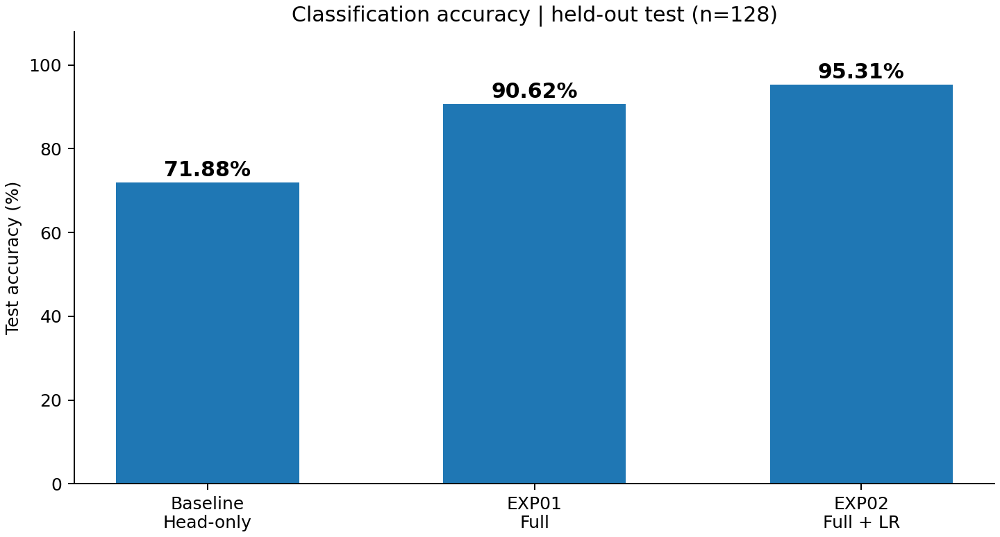
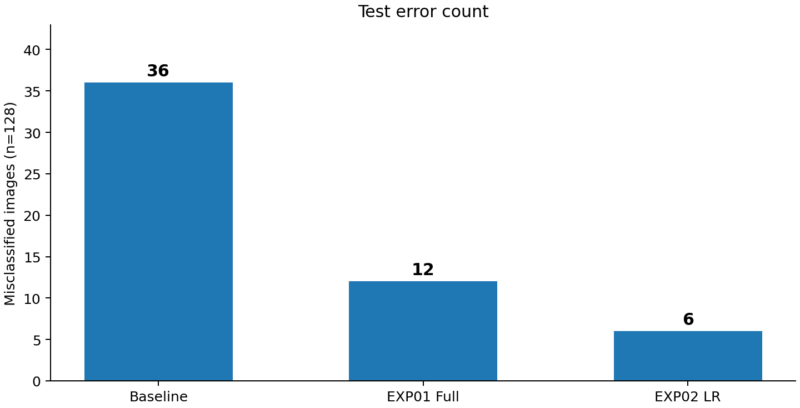
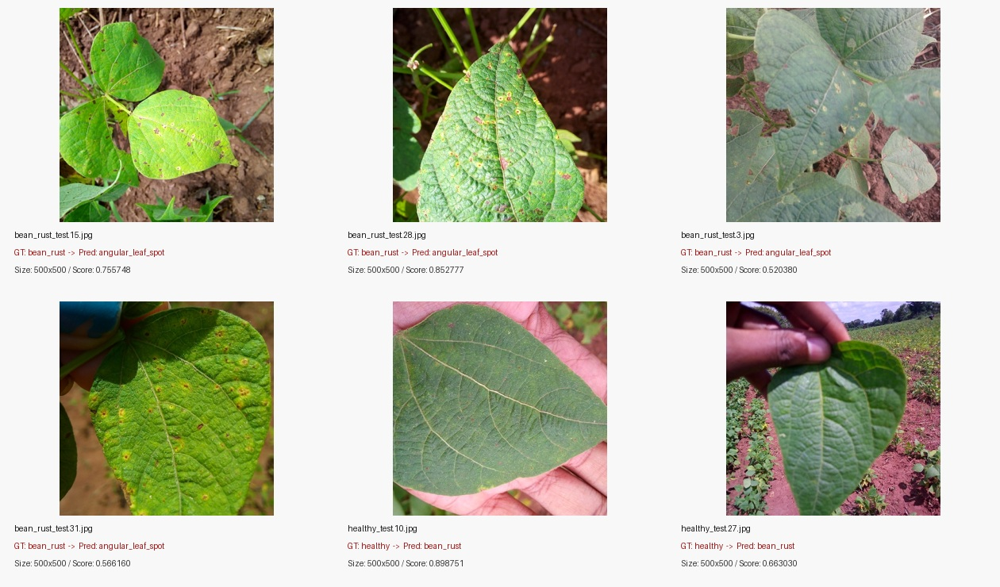

# FastAPI Beans ResNet18 동기·비동기 평가 프로젝트

## 1. 환경
- Windows 11 + WSL2 Ubuntu 26.04.1 LTS
- Python 3.14.4 (WSL 가상환경), Python 3.11 (Docker 컨테이너)
- Docker Desktop / Docker Compose
- Docker: Redis 6379, PostgreSQL 5432
- Docker Compose 서비스: FastAPI, Celery Worker, Redis, PostgreSQL

## 2. 데이터 준비
- 제공 원본 `validation/`의 각 클래스 이미지를 실행용 `dataset/val/`에 배치
- 데이터 클래스: `angular_leaf_spot`, `bean_rust`, `healthy`
- Train 1,034장 / Validation 133장 / Test 128장
- SHA-256 교차 분할 완전 동일 파일 중복 0건; 유사 이미지 중복·원본/실행 데이터의 일대일 매핑은 미확인
- 외부 데이터셋의 사용·재배포 권한 확인 필요

```text
dataset/
├── train/{angular_leaf_spot,bean_rust,healthy}/
├── val/{angular_leaf_spot,bean_rust,healthy}/
└── test/{angular_leaf_spot,bean_rust,healthy}/
```

데이터셋은 GitHub에서 제외되므로 별도 배치가 필요하다.

## 3. 모델 준비 및 실험

| 모델 | 학습 방법 | 모델 경로 | Best Val Accuracy | Test Accuracy |
|---|---|---|---:|---:|
| 초기 Head-only | Backbone freeze | `artifacts/beans_resnet18` | 76.69% | 71.88% |
| EXP01 | Full Fine-tuning | `artifacts/beans_resnet18_full` | 97.74% | 90.63% |
| EXP02 | Full, LR=0.00005 | `artifacts/beans_resnet18_full_lr5e5` | 97.74% | **95.31%** |

**초기 Head-only**

```bash
python -m training.finetune --data dataset --output artifacts/beans_resnet18 --epochs 3 --batch-size 8 --freeze-backbone
```

**EXP01 Full Fine-tuning**

```bash
python -m training.finetune --data dataset --output artifacts/beans_resnet18_full --epochs 3 --batch-size 8
```

**EXP02 Full Fine-tuning + Learning Rate 변경**

```bash
python -m training.finetune --data dataset --output artifacts/beans_resnet18_full_lr5e5 --epochs 3 --batch-size 8 --lr 0.00005
```

- 모두 기존 제공 코드를 사용해 옵션만 변경했다.
- `training/finetune.py`는 Test Accuracy를 자동 계산하지 않으므로 **Test 128장 별도 평가**를 수행했다.
- 각 모델의 폴더에는 `config.json`, `model.safetensors`, `preprocessor_config.json`, `training_report.json`이 생성된다.
- 대용량 모델 가중치와 데이터셋은 저장소에서 제외된다.

### 서비스 모델 경로

```bash
cp .env.example .env
```

**평가 가이드 기준 `.env`**:

```env
MODEL_PATH=artifacts/beans_resnet18
```

외부 이미지 테스트에서는 EXP02 비교를 위해 다음 경로로 전환했다.

```env
MODEL_PATH=artifacts/beans_resnet18_full_lr5e5
```

모델 경로를 변경하면 FastAPI와 Celery Worker를 모두 재생성해야 한다.

```bash
docker compose up -d --force-recreate web worker
```

**주의:** 위 경로 변경은 테스트 전환 예시이며, 실제 현재 `.env`가 어느 모델을 가리키는지는 로컬에서 확인해야 한다. 평가 가이드 기준 경로로 제출하려면 원래 값으로 복구한다.

## 4. 구동 순서

1. 학습 데이터와 필요한 모델 체크포인트를 위 경로에 배치한다.
2. `.env`를 생성하고 `MODEL_PATH`를 확인한다.
3. Docker Compose 실행:

```bash
docker compose up -d --build
```

4. Redis 및 컨테이너 상태 확인:

```bash
docker compose exec redis redis-cli ping
docker compose ps
```

5. 실행 화면:
   - 동기: http://127.0.0.1:8000/vision/sync/
   - 비동기: http://127.0.0.1:8000/vision/async/
   - API 문서: http://127.0.0.1:8000/docs

## 5. API 및 DB 검증

- 동기: 이미지 입력 후 HTTP 200 및 `top1`, `all`, `cache_hit`, `inference_ms` 반환.
- 비동기: HTTP 202 및 `job_id`, `/api/async/jobs/{job_id}/`에서 `done`/결과 확인.
- Redis: 반복 동일 이미지 Cache HIT / MISS 구분.
- PostgreSQL: `image_jobs`의 비동기 작업 상태·예측 결과 기록.
- 예외: 불량 이미지 HTTP 400, 5MB 초과 HTTP 413, 없는 작업번호 HTTP 404.
- Worker 중지 및 복구 실험은 미실시.

## 6. 성능 개선 실험 및 실측 결과





| 지표 | 초기 Head-only | EXP01 | EXP02 |
|---|---:|---:|---:|
| Best Val Accuracy | 76.69% | 97.74% | 97.74% |
| Test Accuracy | 71.88% | 90.63% | **95.31%** |
| 정답 / 128 | 92 | 116 | **122** |
| 오분류 | 36 | 12 | **6** |
| bean_rust Recall | 53.49% | 74.42% | **90.70%** |

- 초기 → EXP01: Backbone 동결 해제, Test Accuracy +18.75%p.
- EXP01 → EXP02: LR 0.0002 → 0.00005, Test Accuracy +4.69%p.
- 총 개선: +23.44%p, 오분류 36 → 6장.

### 최종 모델 오분류 6장



- `bean_rust → angular_leaf_spot`: 4장.
- `healthy → bean_rust`: 2장.
- 6장 모두 원본 500×500px. 질병 병반 시각적 유사성, 조명/색감 등은 **원인 가설**이며 확인된 원인은 아니다.
- 상세: [산출물 1](reports/01_FineTuning_결과보고서.md), [산출물 7](reports/07_기능테스트_오류분석.md).

## 7. 외부 이미지 추가 테스트 (정성 평가)

| 이미지 | 초기 Head-only | EXP02 |
|---|---|---|
| `다운로드.jpg` | bean_rust (77.28%) | bean_rust (94.41%) |
| `images.jpg` | bean_rust (70.35%) | healthy (59.11%) |

- 외부 이미지 2장에 대해 비동기 API가 모두 `done`을 반환했으며, EXP02 `model_id`가 새 모델 경로를 나타냈다.
- 외부 이미지의 실제 정답은 독립적으로 검증하지 않아 **정량 정확도나 일반화 성능 검증으로 계산하지 않는다**.
- API 증빙과 비교: [산출물 7](reports/07_기능테스트_오류분석.md).

## 8. 동기·비동기 성능 비교 (초기 Head-only 서비스)

| 측정 항목 | Cache MISS 5회 중앙값 |
|---|---:|
| Sync HTTP 완료 | 22.499ms |
| Async HTTP 접수 | 7.429ms |
| Async 최종 확인 | 62.997ms |

- 비동기는 접수시간이 66.98% 짧지만 최종 결과 확인은 더 길었다. 모델 자체의 가속으로 해석하지 않는다.
- 외부 이미지 단발 시간은 조건이 달라 이 벤치마크와 직접 비교하지 않았다.

## 9. 제출 산출물

- 보고서: `reports/01_*.md` ~ `reports/08_*.md`.
- 기존 Test 원본: `reports/data/test_metrics.json`, `reports/data/test_predictions.csv`.
- EXP01 Test: `reports/data/full_test_metrics.json`, `reports/data/full_test_predictions.csv`.
- EXP02 Test: `reports/data/exp02_test_metrics.json`, `reports/data/exp02_test_predictions.csv` (**후자 CSV는 로컬 원본을 추가해야 함**).
- 모델 학습 로그: `reports/evidence/head_training_report.json`, `reports/evidence/full_training_report.json`, `reports/evidence/exp02_training_report.json` (EXP02 로그는 실제 출력값을 옮긴 사본).
- 신규 증빙: `reports/evidence/exp_accuracy_comparison.png`, `exp_error_comparison.png`, `exp02_misclassified_montage.jpg`, 외부 이미지 및 API 응답 화면.
- `.env`, `dataset/`, `artifacts/*`, 대용량 ZIP 파일은 공개 저장소에 업로드하지 않는다. 외부 데이터셋은 재배포 라이선스를 확인한 뒤 별도 전달한다.

**제출 주의:** 본 README의 추가 실험은 완료된 사실을 기록했지만 `exp02_test_predictions.csv` 원본과 학습 모델 가중치는 이 묶음에 포함하지 않았다. 사용자 로컬에서 해당 파일을 복사해야 완전한 증빙이 된다.
