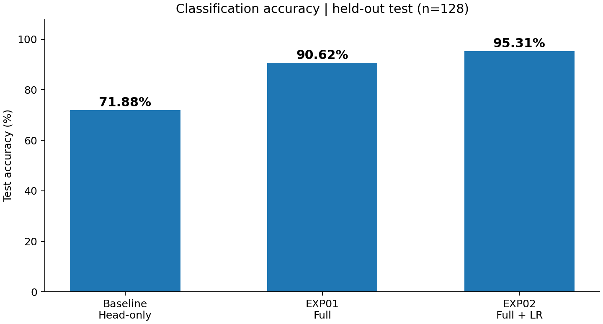
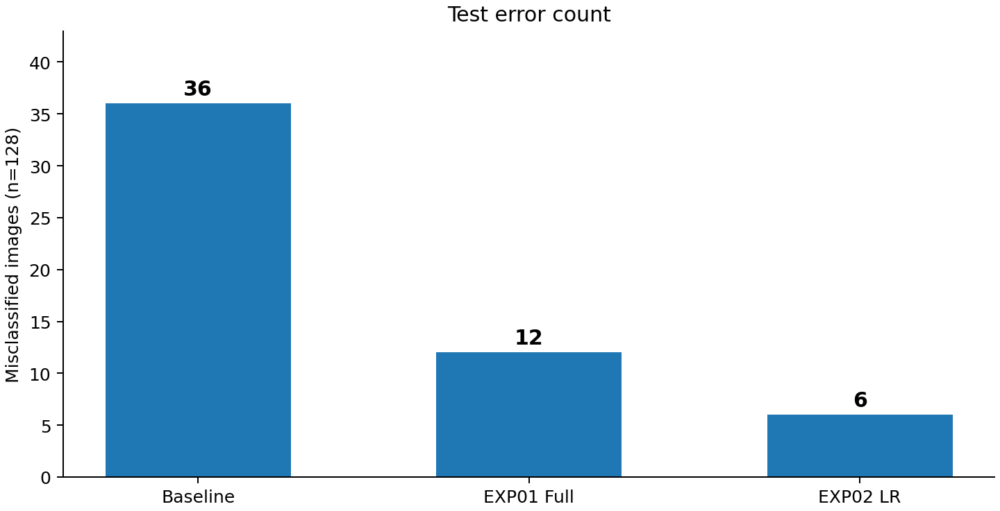
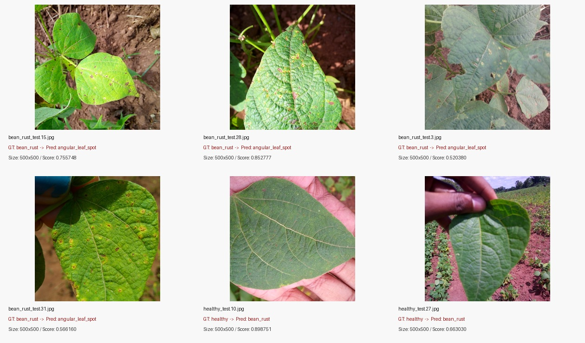

# ResNet18 콩잎 3클래스 Fine-tuning 결과보고서

- 평가 대상: 콩잎 질병 이미지 3종 분류
- 기준 모델: `microsoft/resnet-18`
- 필수 학습 방식: Head-only (Backbone freeze)
- 추가 실험 1: Full Fine-tuning (Backbone 고정 해제)
- 추가 실험 2: Full Fine-tuning + Learning Rate 조정
- 입력 데이터: `dataset/train`, `dataset/val`
- 별도 평가 데이터: `dataset/test` (128장)
- 평가 가이드 기준 서비스 모델: `artifacts/beans_resnet18/`
- 추가 실험 모델: `artifacts/beans_resnet18_full/`, `artifacts/beans_resnet18_full_lr5e5/`
- 상태: 3개 모델의 학습 및 별도 Test 평가 완료

## 1. 데이터 구성

| 클래스 | Train | Validation | Test |
|---|---:|---:|---:|
| angular_leaf_spot | 345 | 44 | 43 |
| bean_rust | 348 | 45 | 43 |
| healthy | 341 | 44 | 42 |
| **합계** | **1,034** | **133** | **128** |

- 원본 폴더: `train / validation / test`; 실행 폴더: `train / val / test`.
- 교차 분할 SHA-256 동일 파일 중복은 0건. 유사 이미지 중복 및 원본-실행 데이터 간 일대일 해시 대응은 별도로 검증하지 않았다.
- 근거: `evidence/dataset_check.txt`.

## 2. 실행 설정

| 조건 | 초기 Head-only | EXP01 Full | EXP02 Full + LR 조정 |
|---|---|---|---|
| Base model | `microsoft/resnet-18` | 동일 | 동일 |
| Epoch | 3 | 3 | 3 |
| Batch size | 8 | 8 | 8 |
| Learning rate | 0.0002 | 0.0002 | **0.00005** |
| Backbone | Freeze | 학습 | 학습 |
| Seed | 42 | 42 | 42 |
| 모델 출력 경로 | `artifacts/beans_resnet18` | `artifacts/beans_resnet18_full` | `artifacts/beans_resnet18_full_lr5e5` |

- 세 모델은 `training/finetune.py`의 학습 옵션을 변경하여 실행하였다. 코드를 수정하여 새로운 학습 알고리즘을 구현한 것은 아니다.
- 해당 코드의 학습 결과 JSON에는 Train Loss, Validation Accuracy가 기록되며, **Test 평가는 별도로 수행**하였다.

## 3. 학습 결과

### 3-1. 초기 Head-only 학습 및 Test 평가

| Epoch | Train Loss | Validation Accuracy |
|---|---:|---:|
| 1 | 0.9924 | 66.17% |
| 2 | 0.8108 | 76.69% |
| 3 | 0.7078 | 76.69% |

- Best Validation Accuracy: 76.69%
- Test Accuracy: **92/128 = 71.875%** (표시 시 71.88%)
- Test 오분류: **36장**
- Test Macro Precision: 0.7149 / Macro Recall: 0.7204 / Macro F1: 0.7109
- 평가 근거: `data/test_metrics.json`, `data/test_predictions.csv`

**초기 모델 Test 혼동행렬** — 행: 실제 정답 / 열: 예측

| 실제 \ 예측 | angular_leaf_spot | bean_rust | healthy |
|---|---:|---:|---:|
| angular_leaf_spot | **30** | 7 | 6 |
| bean_rust | 13 | **23** | 7 |
| healthy | 0 | 3 | **39** |

| 클래스 | Precision | Recall | F1-score |
|---|---:|---:|---:|
| angular_leaf_spot | 0.6977 | 0.6977 | 0.6977 |
| bean_rust | 0.6970 | 0.5349 | 0.6053 |
| healthy | 0.7500 | 0.9286 | 0.8298 |

**해석:** `bean_rust` 43장 중 23장만 정분류되어 Recall이 53.49%로 가장 낮았으며, 그중 13장은 `angular_leaf_spot`으로 분류되었다.

### 3-2. 추가 실험 EXP01: Full Fine-tuning

**변경 사항:** `--freeze-backbone`을 제외하여 Backbone과 분류 헤드를 함께 학습하도록 설정했다. 데이터 분할, Epoch, Batch size, LR은 유지했다.

```bash
python -m training.finetune --data dataset --output artifacts/beans_resnet18_full --epochs 3 --batch-size 8
```

| Epoch | Train Loss | Validation Accuracy |
|---|---:|---:|
| 1 | 0.4160 | 91.73% |
| 2 | 0.2059 | **97.74%** |
| 3 | 0.1230 | 95.49% |

- Best Validation Accuracy: **97.74%** (Epoch 2)
- Test Accuracy: **116/128 = 90.625%** (표시 시 90.63%)
- Test 오분류: **12장**
- 초기 대비 Test Accuracy **+18.75%p**, 오분류 **36 → 12장**
- 근거: `evidence/full_training_report.json`, `data/full_test_metrics.json`, `data/full_test_predictions.csv`

**EXP01 Test 혼동행렬**

| 실제 \ 예측 | angular_leaf_spot | bean_rust | healthy |
|---|---:|---:|---:|
| angular_leaf_spot | **43** | 0 | 0 |
| bean_rust | 11 | **32** | 0 |
| healthy | 1 | 0 | **41** |

**남은 문제:** `bean_rust`의 11/43장이 `angular_leaf_spot`으로 오분류되었다. 단, Backbone 전체 학습이 개선 원인이라고 단정하기보다는 **변경 조건과 정확도 증가의 연관성을 관찰**한 것이다.

### 3-3. 추가 실험 EXP02: Learning Rate 감소

**변경 사항:** Full Fine-tuning을 유지하고 LR만 `0.0002`에서 `0.00005`로 낮추었다. 데이터 분할, Epoch, Batch size는 동일하다.

```bash
python -m training.finetune --data dataset --output artifacts/beans_resnet18_full_lr5e5 --epochs 3 --batch-size 8 --lr 0.00005
```

| Epoch | Train Loss | Validation Accuracy |
|---|---:|---:|
| 1 | 0.4407 | **97.74%** |
| 2 | 0.1555 | 96.24% |
| 3 | 0.0859 | 95.49% |

- Best Validation Accuracy: **0.9774436090225563 = 97.74%** (Epoch 1)
- 별도 Test 평가: **122/128 = 95.3125%** (표시 시 95.31%)
- Test 오분류: **6장**
- EXP01 대비 Test Accuracy **+4.6875%p**, 오분류 **12 → 6장**
- 원본 학습 결과: `artifacts/beans_resnet18_full_lr5e5/training_report.json` (로컬 모델 폴더)
- 별도 평가 결과: `data/exp02_test_metrics.json`, `data/exp02_test_predictions.csv` (로컬에서 생성한 실제 평가 CSV를 함께 제출)

**EXP02 Test 혼동행렬**

| 실제 \ 예측 | angular_leaf_spot | bean_rust | healthy |
|---|---:|---:|---:|
| angular_leaf_spot | **43** | 0 | 0 |
| bean_rust | 4 | **39** | 0 |
| healthy | 0 | 2 | **40** |

- `bean_rust` Recall: **39/43 = 90.70%** (초기 53.49%, EXP01 74.42%).
- `healthy` Recall: **40/42 = 95.24%** (EXP01 41/42 = 97.62%에서 1장 감소).
- 학습 Loss는 Epoch 3까지 감소했으나 Validation Accuracy는 Epoch 1 이후 하락했다. 따라서 Loss 감소가 곧 Validation 개선을 의미하지는 않는다.
- EXP01과 EXP02의 Best Validation Accuracy는 같지만, 동일 Test 분할에 대한 정답 개수는 각각 116장과 122장이었다.

### 3-4. 세 모델 성능 비교





| 지표 | 초기 Head-only | EXP01 Full | EXP02 Full+LR |
|---|---:|---:|---:|
| Best Validation Accuracy | 76.69% | 97.74% | 97.74% |
| **Test Accuracy** | **71.88%** | **90.63%** | **95.31%** |
| Test 정답/128 | 92 | 116 | 122 |
| Test 오분류 | 36 | 12 | 6 |
| bean_rust Recall | 53.49% | 74.42% | 90.70% |

**전체 변화:** 초기 대비 EXP02의 Test Accuracy는 **+23.4375%p** (표시 시 +23.44%p), 오분류는 **36 → 6장**이다.

**평가상 주의:** 동일한 Test 분할에서 여러 추가 실험의 결과를 사후 비교한 것이므로, 이번 결과를 근거로 최적 학습률을 확정하거나 새로운 데이터에서의 일반화 성능이 95.31%라고 주장할 수는 없다. 향후 학습률 선택에는 Validation 데이터를 사용하고 최종 성능은 새로운 독립 Test에서 평가해야 한다.

### 3-5. EXP02 오분류 6장 분석



| 오분류 파일 | 실제 정답 | 모델 예측 | 잘못 예측한 클래스 점수 |
|---|---|---|---:|
| `bean_rust_test.15.jpg` | bean_rust | angular_leaf_spot | 75.57% |
| `bean_rust_test.28.jpg` | bean_rust | angular_leaf_spot | 85.28% |
| `bean_rust_test.3.jpg` | bean_rust | angular_leaf_spot | 52.04% |
| `bean_rust_test.31.jpg` | bean_rust | angular_leaf_spot | 56.62% |
| `healthy_test.10.jpg` | healthy | bean_rust | 89.88% |
| `healthy_test.27.jpg` | healthy | bean_rust | 66.30% |

- **관찰:** Rust 4장에 작은 갈색·노란색 반점이 나타나며, 실제 건강 라벨 2장도 Rust로 분류됐다.
- **관찰:** 일부 오분류는 예측 점수가 높다. 예를 들어 `healthy_test.10.jpg`의 잘못된 Rust 예측 점수는 89.88%였다. 이 점수는 실제 정답 확률이나 신뢰성 보증을 뜻하지 않는다.
- **관찰:** 이 6장의 원본 해상도는 모두 **500×500**이다. 따라서 이들 사이에서 해상도 차이를 단독 원인으로 제시할 수 없다.
- **가능한 원인 가설(미검증):** 서로 유사한 병반 표현, 촬영 조명/색감, 잎과 배경의 구성.
- **후속 개선 제안(미실행):** 잎 영역 Crop, 조명 변화 증강, 클래스별 Recall 분석 및 독립 Validation 평가.

## 4. 생성 파일 확인

학습 결과 로컬 폴더마다 다음 파일의 생성을 확인하였다.

- [x] `config.json`
- [x] `model.safetensors`
- [x] `preprocessor_config.json`
- [x] `training_report.json`

모델 가중치와 원본 데이터셋은 저장소 용량 제한 및 재배포 권한 검토를 위해 GitHub 제출에서 제외하였다.

## 5. 서비스 연결 확인

- 초기 서비스 설정: `.env`의 `MODEL_PATH=artifacts/beans_resnet18` (Head-only).
- 기존 동기 API에서 `healthy_test.6.jpg`를 `healthy`로 분류, 점수 약 0.6201.
- 외부 이미지 추가 비교를 위해 FastAPI와 Celery Worker를 재생성해 EXP02 모델 `artifacts/beans_resnet18_full_lr5e5`를 실제 비동기 API에 연결했으며 `model_id`로 확인했다.
- **이는 평가 가이드의 기준 경로 변경이 아닌 별도 추가 비교 테스트를 위한 임시 모델 전환이다.** 기준 서비스 환경으로 제출하려면 `.env`를 `MODEL_PATH=artifacts/beans_resnet18`로 복구하고 Web/Worker를 재생성해야 한다.
- 비교 내용은 [산출물 7](07_기능테스트_오류분석.md) 참고.

## 6. 결과 판정

- 완료: Head-only, Full Fine-tuning, LR 감소 추가 실험 3종 및 각 모델의 독립 실행 Test 평가.
- Test Accuracy: **71.88% → 90.63% → 95.31%**.
- EXP02 오분류 6장 중 `bean_rust → angular_leaf_spot` 4장, `healthy → bean_rust` 2장.
- 한계: 외부 이미지 정답 미검증, Test 재사용에 따른 모델 선택 편향 위험, 단일 데이터 분할, 유사 이미지 중복 검증 부재.
- 추후 실험: 이미지를 Crop하거나 조명/대비를 바꾸어 예측 변화와 Validation의 클래스별 Recall을 비교. **수행한 실험으로 기재하지 않는다.**

### 실행 명령 기록

**Head-only**

```bash
python -m training.finetune --data dataset --output artifacts/beans_resnet18 --epochs 3 --batch-size 8 --freeze-backbone
```

**EXP01 Full Fine-tuning**

```bash
python -m training.finetune --data dataset --output artifacts/beans_resnet18_full --epochs 3 --batch-size 8
```

**EXP02 Full Fine-tuning + LR 0.00005**

```bash
python -m training.finetune --data dataset --output artifacts/beans_resnet18_full_lr5e5 --epochs 3 --batch-size 8 --lr 0.00005
```

### 학습 결과 기록 참조

- 기존 Head-only: `evidence/head_training_report.json`.
- 기존 EXP01 Full: `evidence/full_training_report.json`.
- EXP02: 로컬 원본 `artifacts/beans_resnet18_full_lr5e5/training_report.json` 및 제공된 실측 내용을 옮긴 `evidence/exp02_training_report.json`.
- 초기 Test: `data/test_metrics.json` / EXP01 Test: `data/full_test_metrics.json` / EXP02 Test: `data/exp02_test_metrics.json`.
