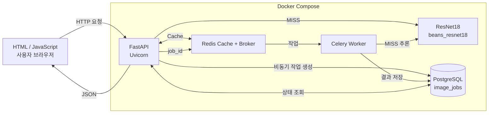

# 전체 시스템 아키텍처 설계서

| 컴포넌트 | 실행 위치 | 사용 파일 / 서비스 | 역할 |
|---|---|---|---|
| 브라우저 | Windows 웹브라우저 | `templates/sync.html`, `templates/async.html` | 파일 업로드·결과 표시 |
| FastAPI | Docker Compose `web` 컨테이너 | `main.py`, `ai/router_sync.py`, `ai/router_async.py` | HTTP 요청·검증·응답 |
| ResNet18 | Docker `web` / `worker` 컨테이너 | `ai/hf_model.py`, `artifacts/beans_resnet18/` | 이미지 분류 |
| Redis Cache | Docker Redis DB/1 | `ai/cache_service.py` | 동일 이미지·동일 모델 결과 재사용 |
| Redis Broker | Docker Redis DB/2 | `ai/celery_app.py` | Celery 작업 전달 |
| PostgreSQL | Docker `postgres` 컨테이너 | `ai/models.py`, `image_jobs` | 비동기 작업 상태·결과 |
| Celery Worker | Docker Compose `worker` 컨테이너 | `ai/tasks.py` | 비동기 추론·DB 갱신 |

**실행환경**

- 운영체제: Windows 11 + WSL2 Ubuntu 26.04.1 LTS
- Python: WSL 가상환경 3.14.4 / Docker 컨테이너 3.11
- Docker 서비스: FastAPI, Celery Worker, Redis, PostgreSQL
- 서버 프로세스: FastAPI Uvicorn
- 워커 프로세스: Celery solo, concurrency=1
- 모델 경로: artifacts/beans_resnet18

**구조 검증 결과**

- 동기: 브라우저 → FastAPI → Redis Cache(MISS) → ResNet18 → FastAPI → 브라우저
- 비동기: 브라우저 → FastAPI → PostgreSQL(queued) → Redis Broker → Worker → PostgreSQL(done) → 브라우저 조회
- 동기 호출 결과는 image_jobs에 자동 저장하지 않음
- Docker Compose에서 web, worker, redis, postgres 4개 서비스 실행 확인
- Celery Worker의 작업 처리 및 PostgreSQL의 done 상태 확인

**증빙**

- `evidence/compose_ps.txt`
- `evidence/worker_web_logs.txt`
- `evidence/db_jobs.txt`
- `evidence/cache_hit_retest.json`