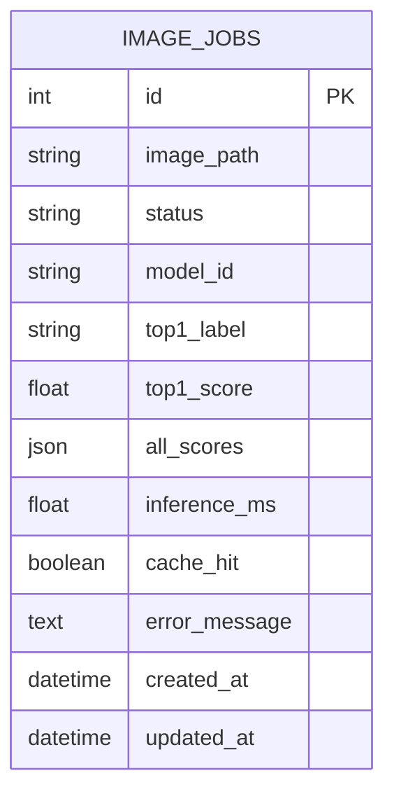

**테이블명:** `image_jobs` · **PK:** `id` · **저장 대상:** 비동기 추론의 작업 상태 및 결과



| 컬럼 | DB 자료형(제공 코드 기준) | Nullable / 기본 | 예시 값 | 사용 이유 |
|---|---|---|---|---|
| id | INTEGER | PK | 20 | 고유 작업번호 |
| image_path | VARCHAR(150) | 필수 | UUID 기반 `.bin` 파일명 | 파일 찾기 |
| status | VARCHAR(20) | 기본 `queued` | `done` | 처리 상태 |
| model_id | VARCHAR(255) | 기본 빈문자 | `artifacts/beans_resnet18` | 모델 식별 |
| top1_label | VARCHAR(200) | NULL | `angular_leaf_spot` | 최종 분류 라벨 |
| top1_score | FLOAT | NULL | 0.46233341097831726 | 분류 점수 |
| all_scores | JSON | NULL | `[{"label":"angular_leaf_spot","score":0.46233341097831726}]` | 전체 클래스 점수 |
| inference_ms | FLOAT | NULL | 22.31 | 실추론시간 |
| cache_hit | BOOLEAN | NULL | true | 캐시 재사용 여부 |
| error_message | TEXT | NULL | NULL | 실패 원인 |
| created_at | TIMESTAMPTZ | 기본 UTC 현재시각 | 2026-11-04 02:18:30.573166+00 | 생성 시점 |
| updated_at | TIMESTAMPTZ | 기본 UTC 현재시각 | 2026-11-04 02:18:30.584615+00 | 갱신 시점 |

**SQL 조회**

```sql
SELECT id, status, image_path, model_id, top1_label, top1_score,
       inference_ms, cache_hit, created_at, updated_at
FROM image_jobs
ORDER BY id DESC
LIMIT 10;
```

**조회 결과 기록**

| id | status | top1_label | top1_score | cache_hit | 판정 |
|---|---|---|---:|---|---|
| 20 | done | angular_leaf_spot | 0.46233341097831726 | true | 캐시 결과 재사용 |
| 19 | done | bean_rust | 0.5147417187690735 | false | 비동기 추론 완료 |
| 13 | done | healthy | 0.6200540661811829 | true | 캐시 결과 재사용 |

**상태 전이:** `queued → running → done` / 오류 시 `failed`  
**이미지 실제 저장 위치:** `media/jobs/<uuid>.bin` (DB 원본 이미지 바이너리 미저장)  
**동기 요청의 DB 행 생성:** 기본 제공 코드에서는 생성하지 않음

**증빙 경로:** `evidence/db_jobs.txt`, `evidence/db_result.png`

**제출 점검:** `image_jobs` 테이블의 작업 ID 1~20을 조회한 결과 모두 `done` 상태로 확인되었으며, `failed` 상태의 작업은 관찰되지 않았다.