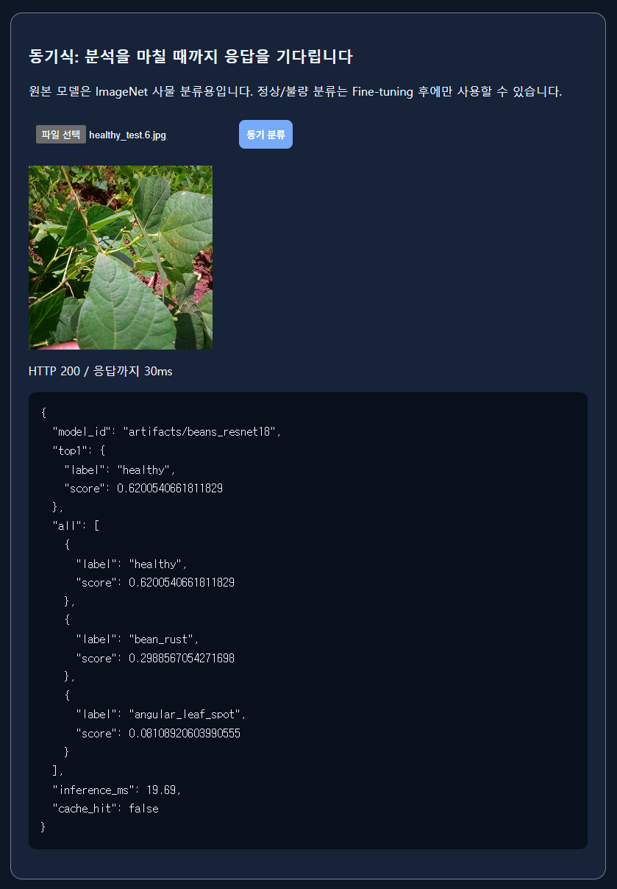
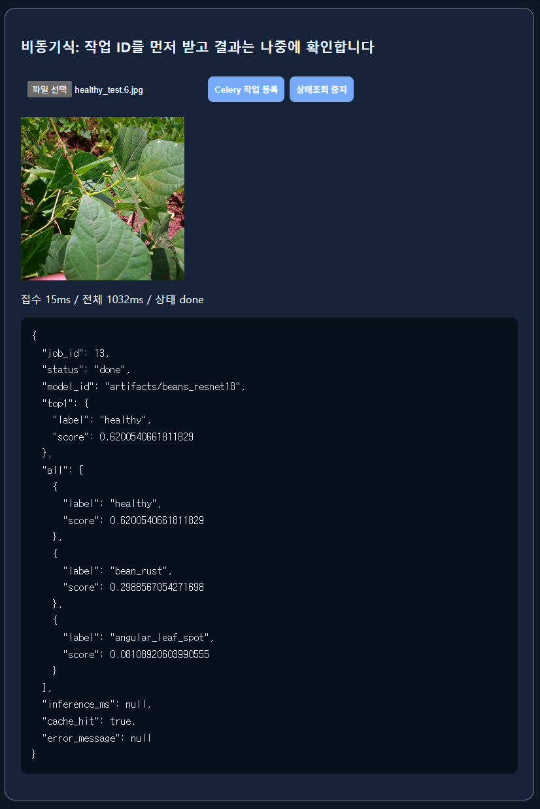
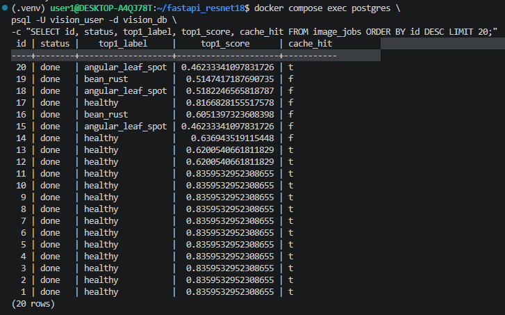
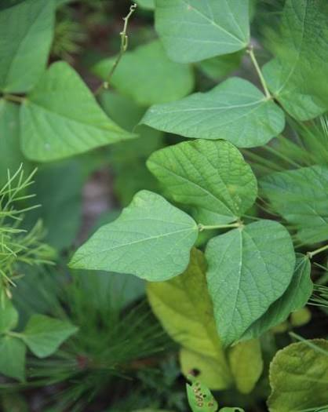
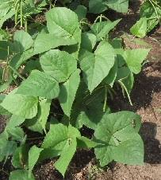
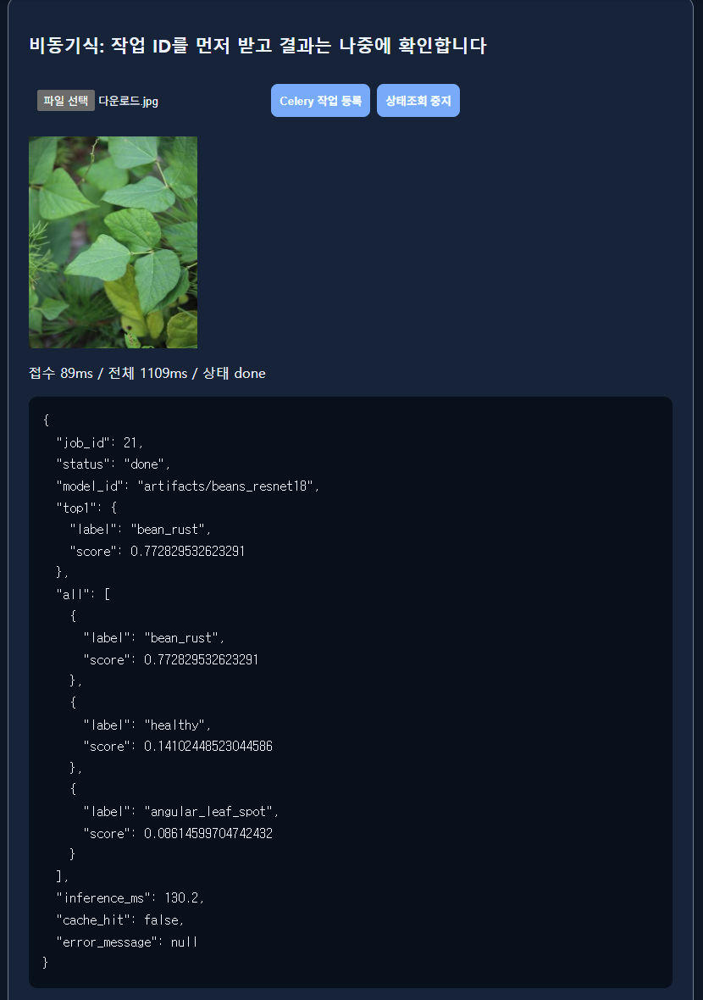
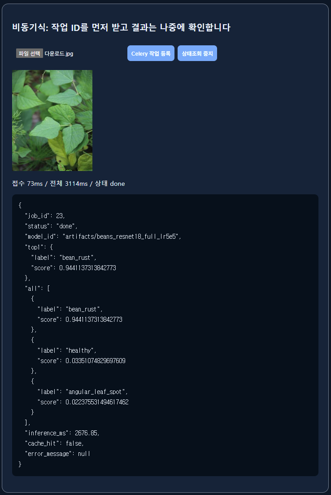
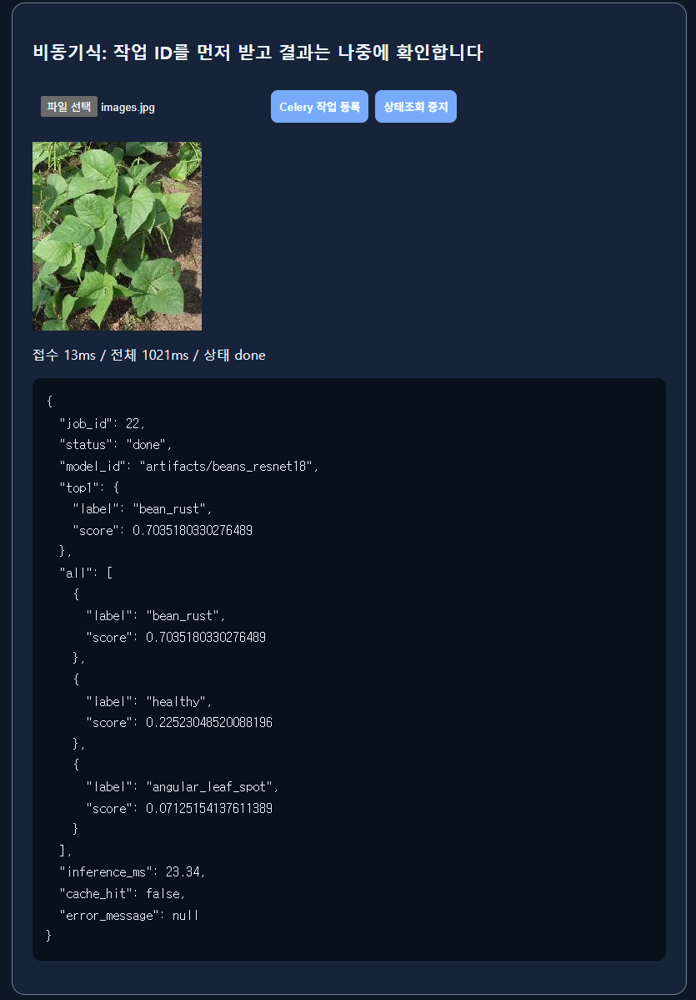
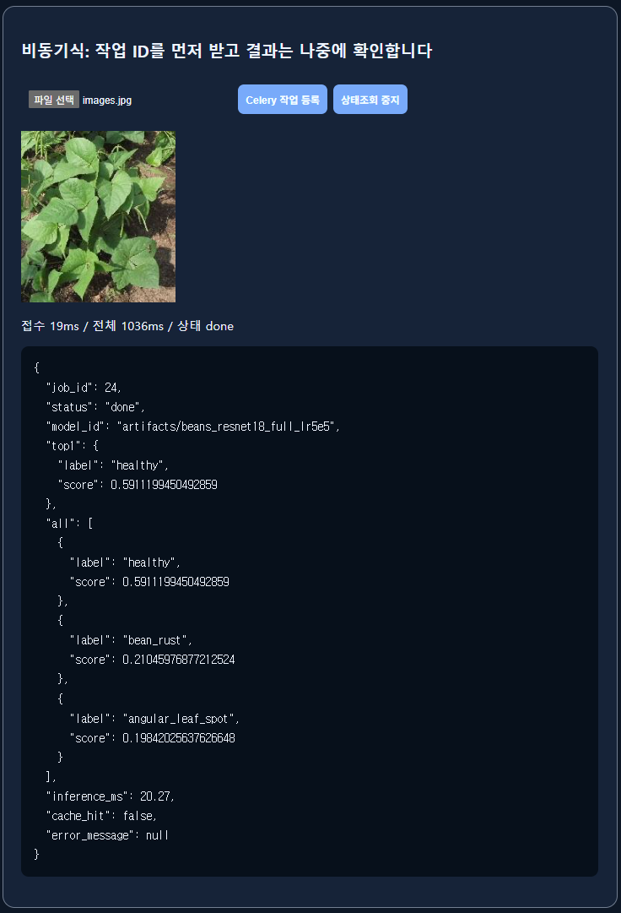
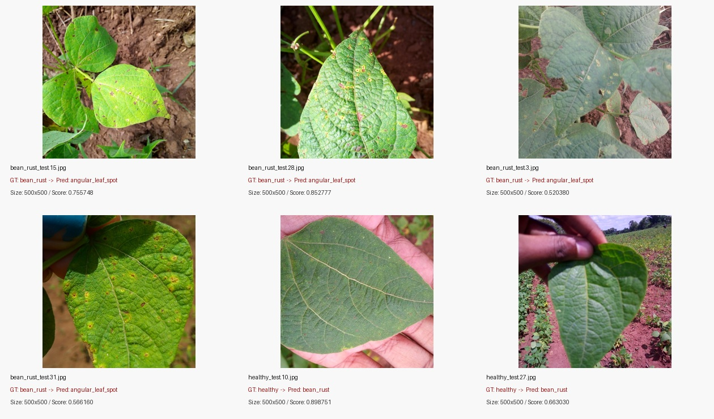

# 기능 테스트 및 오류 분석 기록서

| Test ID | 확인 항목 | 테스트 입력·절차 | 기대 결과 | 실제 결과 | 판정 | 증빙 |
|---|---|---|---|---|---|---|
| T-01 | FastAPI 헬스 | GET `/health` | 200 / ok | 200 / ok | PASS | `evidence/health.json` |
| T-02 | 모델 동기 추론 | `healthy_test.6.jpg` 업로드 | 200 / 클래스 JSON | 200 / healthy | PASS | `evidence/sync_ui.png` |
| T-03 | 비동기 접수 | `healthy_test.6.jpg` 업로드 | 202 / job_id | 202 / 13 | PASS | `evidence/worker_web_logs.txt` |
| T-04 | 비동기 완료 | GET `/api/async/jobs/13/` | 200 / done | 200 / done | PASS | `evidence/async_ui.png` |
| T-05 | Redis 연결 | Redis 캐시·브로커 연결 확인 | 정상 연결 | Redis 캐시 HIT 및 Worker 연결 확인 | PASS | `evidence/cache_hit_retest.json`, `evidence/worker_web_logs.txt` |
| T-06 | DB 기록 | `image_jobs` 조회 | id=20, done | id=20, done | PASS | `evidence/db_jobs.txt` |
| T-07 | 불량 입력 | 잘못된 이미지 파일 업로드 | HTTP 400 | 400 | PASS | `evidence/real_error_responses.json` |
| T-08 | 없는 작업번호 | GET `/api/async/jobs/99999999/` | HTTP 404 | 404 | PASS | `evidence/real_error_responses.json` |
| T-09 | 캐시 반복 | 동일 파일 재요청 | MISS → HIT | MISS → HIT | PASS | `evidence/cache_hit_retest.json`, `evidence/miss_paired_raw.json` |
| T-10 | Worker 미실행 | Worker 정지 후 접수 | 대기 또는 오류 원인 확인 | 미실시 | 미실시 | — |
| T-11 | 파일 크기 초과 | 5MB 초과 파일 업로드 | HTTP 413 | 413 | PASS | `evidence/real_error_responses.json` |

**오류 이력**

| 오류 ID | 현상 | 원인 확인 | 조치 | 재검증 | 결과 |
|---|---|---|---|---|---|
| E-01 | 잘못된 이미지 업로드 시 HTTP 400 | 이미지 디코딩 실패 | 이미지 유효성 검증 및 오류 응답 확인 | 잘못된 이미지 업로드 | 400 응답 확인 |
| E-02 | 5MB 초과 파일 업로드 시 HTTP 413 | 허용 파일 크기 초과 | 업로드 크기 제한 확인 | 5MB 초과 파일 업로드 | 413 응답 확인 |
| E-03 | 존재하지 않는 작업번호 조회 시 HTTP 404 | DB에 해당 작업번호 없음 | 작업 존재 여부 확인 | 존재하지 않는 job_id 조회 | 404 응답 확인 |

**테스트 구분**

- 단위·모의 테스트: 가짜 모델/DB를 사용하는 테스트 코드와 실환경 테스트 결과를 구분하였다.
- 실환경 통합 테스트: ResNet18, Redis, PostgreSQL, Celery를 연결하여 동기·비동기 분류 및 작업 기록을 확인하였다.
- Worker 중지 및 복구 실험은 수행하지 않았다.

**검증 증빙 파일명과 본문 연결**

- Celery Worker 로그: `evidence/worker_web_logs.txt`
- 오류 응답: `evidence/real_error_responses.json`

---

## 추가 기능 테스트: 외부 이미지에 대한 모델별 비동기 예측 비교

**목적:** 제공된 Test 분할 밖에서 검색한 유사 콩잎 이미지 2장을 Head-only 서비스와 EXP02 서비스에 동일하게 입력하여 예측 결과가 어떻게 달라지는지 관찰한다. 외부 이미지의 참값은 독립적으로 검증되지 않았으므로 이 테스트는 **정성 확인**이며 정량 정확도 평가에 포함하지 않는다.

| 외부 이미지 | 원본 크기 | 초기 Head-only (`beans_resnet18`) | EXP02 (`beans_resnet18_full_lr5e5`) |
|---|---:|---|---|
| `다운로드.jpg` | 418×525 | bean_rust / 0.7728295 | bean_rust / 0.9441373 |
| `images.jpg` | 203×226 | bean_rust / 0.7035180 | healthy / 0.5911199 |

**API 검증:** Head-only 비동기 작업 `job_id=21,22`, EXP02 비동기 작업 `job_id=23,24` 모두 `done`; EXP02 응답의 `model_id`는 `artifacts/beans_resnet18_full_lr5e5`였다. 네 요청의 `cache_hit` 값은 모두 `false`였다.

**표의 점수는 해당 모델의 예측 클래스 출력 점수이며 정답률이 아니다.** 첫 번째 이미지는 모델 변경 후에도 예측 클래스는 같았으나 출력 점수가 달라졌고, 두 번째 이미지는 예측 클래스 자체가 `bean_rust → healthy`로 바뀌었다. 실제 정답이 검증되지 않았으므로 어느 모델의 예측이 맞는지 판단할 수 없다.

### 외부 이미지 및 실제 API 응답 화면

| 이미지 A (`다운로드.jpg`) | 이미지 B (`images.jpg`) |
|---|---|
|  |  |

| 구분 | 초기 Head-only | 최종 EXP02 |
|---|---|---|
| 이미지 A |  |  |
| 이미지 B |  |  |

**외부 이미지 한계:** 서로 다른 사진 2장만 테스트했으며, 두 번째 이미지의 상대적으로 작은 잎과 해상도 차이가 예측에 영향을 주었을 가능성은 있으나 통제 실험을 수행하지 않았다. 추가로 이미지 크기·Crop·배경 영향을 평가할 수 있다.

## 추가 오류 분석: EXP02 Test 오분류 6장

| 파일 | 실제 정답 | 예측 | 잘못 예측한 클래스 점수 |
|---|---|---|---:|
| `bean_rust_test.15.jpg` | bean_rust | angular_leaf_spot | 0.755748 |
| `bean_rust_test.28.jpg` | bean_rust | angular_leaf_spot | 0.852777 |
| `bean_rust_test.3.jpg` | bean_rust | angular_leaf_spot | 0.520380 |
| `bean_rust_test.31.jpg` | bean_rust | angular_leaf_spot | 0.566160 |
| `healthy_test.10.jpg` | healthy | bean_rust | 0.898751 |
| `healthy_test.27.jpg` | healthy | bean_rust | 0.663030 |

- 네 Rust 이미지에는 여러 반점이 보여 시각적으로 다른 병해와 혼동했을 가능성이 있다.
- 정상 잎 2장도 Rust로 예측하여 **정상→질병 오탐**이 남았다.
- 전부 원본 500×500 픽셀이므로 이 여섯 이미지의 오분류를 해상도 크기 차이만으로 설명할 수 없다.
- 병반 유사성, 조명, 색감, 배경은 **검증 전 가설**이다. Crop/CLAHE/Grad-CAM/HSV 등의 실제 추가 수행 결과는 없다.

**추가 원본 자료:** `data/exp02_test_metrics.json`, 로컬에서 실제 평가로 생성한 `data/exp02_test_predictions.csv`, `evidence/exp02_misclassified_montage.jpg`.
