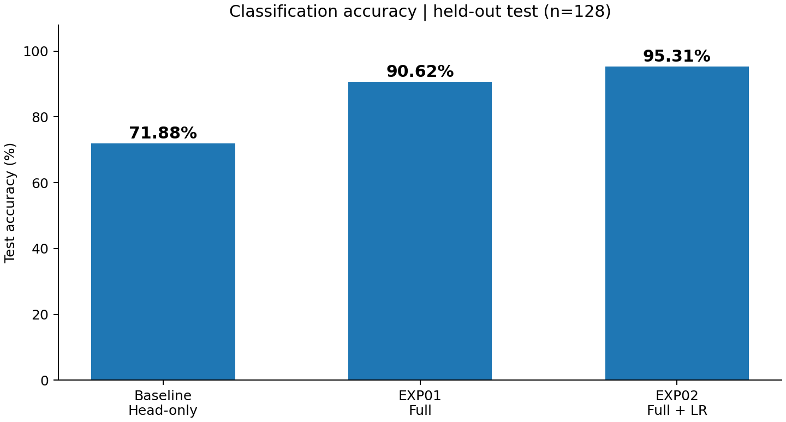
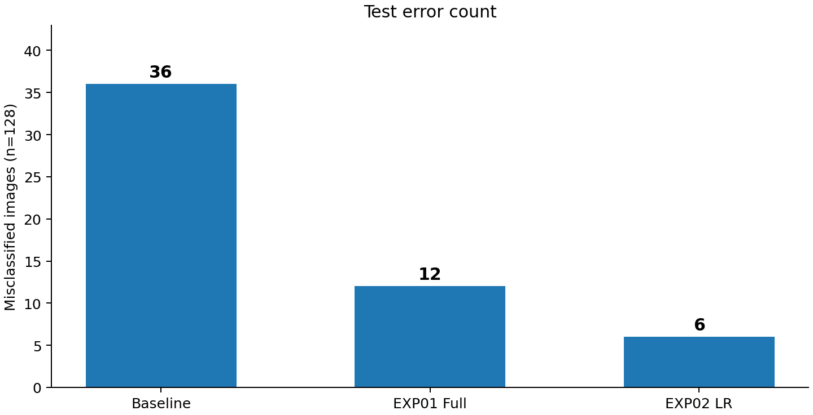
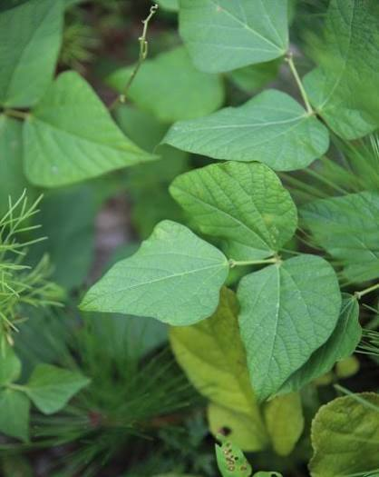
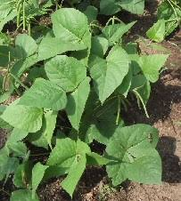
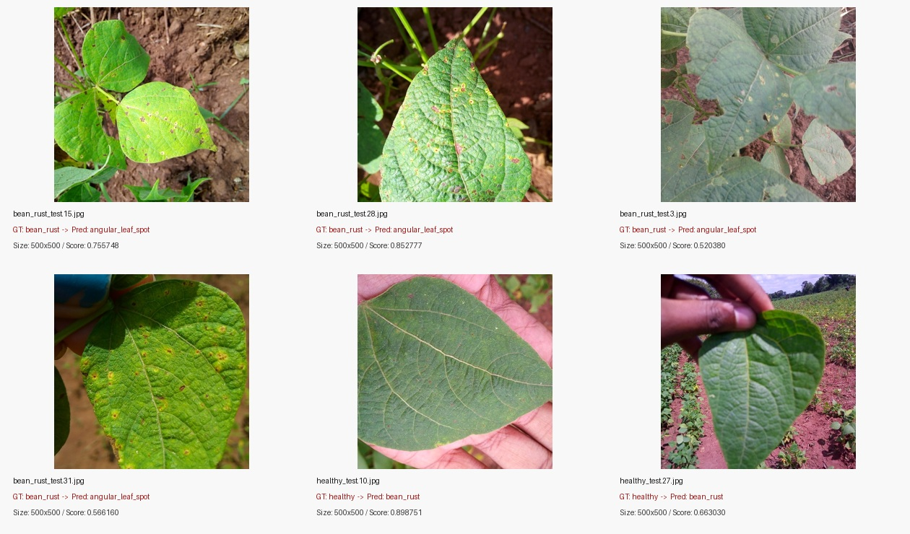

# 콩잎 질병 분류 Vision AI API 서비스 기술보고서

## 1. 프로젝트 정보
- 프로젝트: ResNet18 기반 Beans 3클래스 분류 및 동기·비동기 서빙
- 입력: JPG/PNG/WEBP (5MB 이하)
- 출력: angular_leaf_spot / bean_rust / healthy
- 모델: microsoft/resnet-18 → 학습 결과 모델 파일
- 기준 서비스 모델: `artifacts/beans_resnet18`
- 추가 실험: `artifacts/beans_resnet18_full`, `artifacts/beans_resnet18_full_lr5e5`
- 실행구조: FastAPI·Celery·Redis·PostgreSQL(Docker Compose)

## 2. 모델 학습 결과 요약

| 항목 | 초기 Head-only | EXP01 Full | EXP02 Full + LR |
|---|---:|---:|---:|
| Train / Val / Test | 1,034 / 133 / 128 | 동일 | 동일 |
| Backbone | 고정 | 학습 | 학습 |
| Epoch / Batch | 3 / 8 | 3 / 8 | 3 / 8 |
| LR | 0.0002 | 0.0002 | 0.00005 |
| Best Validation Accuracy | 76.69% | 97.74% | 97.74% |
| **Test Accuracy** | **71.88%** | **90.63%** | **95.31%** |
| Test 정답 / 128 | 92 | 116 | 122 |
| Test 오분류 | 36 | 12 | 6 |

- Head-only에서 Full Fine-tuning으로 변경하여 Test Accuracy **+18.75%p**.
- Full의 학습률을 0.0002에서 0.00005로 변경하여 Test Accuracy **+4.6875%p**.
- 초기 대비 EXP02 Test Accuracy **+23.4375%p**, 오분류 **36 → 6장**.
- EXP02의 `bean_rust` Recall은 **39/43 = 90.70%**.
- 근거 문서: [산출물 1](01_FineTuning_결과보고서.md)
- 실험 원본: `evidence/head_training_report.json`, `evidence/full_training_report.json`, `evidence/exp02_training_report.json`, `data/exp02_test_metrics.json`.

## 3. 아키텍처 및 데이터 흐름
- 동기: Browser → FastAPI → Redis Cache → (MISS인 경우) Model → JSON
- 비동기: Browser → FastAPI → PostgreSQL Job → Redis Broker → Celery Worker → Cache/Model → DB → 상태조회
- 근거 문서: [산출물 2](02_시스템_아키텍처.md)

## 4. API·DB 설계
- 핵심 API: 동기 분류, 비동기 접수, 상태 조회, health
- DB: PostgreSQL `image_jobs`, 비동기 작업 추적
- 근거 문서: [산출물 3](03_API_명세서.md) / [산출물 4](04_DB_구조_작업이력.md)

## 5. 실제 버튼 처리 검증
- 동기식: 분류 완료 후 응답
- 비동기식: HTTP 202 및 job_id 수신 후 폴링으로 완료 확인
- 외부 이미지 비동기 추가 테스트: Head-only (`job_id=21,22`)와 EXP02 (`job_id=23,24`) 모두 `done` 확인
- 근거 문서: [산출물 5](05_AI버튼_처리흐름.md) / [산출물 7](07_기능테스트_오류분석.md)

## 6. 실제 성능 비교 — Head-only 기준 서비스의 기존 벤치마크

| 항목 | 5회 Cache MISS 중앙값 |
|---|---:|
| Sync MISS HTTP 완료 | 22.499ms |
| Async MISS HTTP 접수 | 7.429ms |
| Async MISS 최종 확인 | 62.997ms |

- 비동기 HTTP 접수시간은 동기 대비 66.98% 단축됐으나 최종 결과 확인은 40.498ms 더 오래 걸렸다.
- 이 수치는 **모델 추론 속도 향상이 아니라 접수와 실제 작업의 분리**를 보여준다.
- 외부 이미지 테스트의 작업 시간은 서로 다른 사진·상태에서 단발 측정한 결과이므로 이 5회 벤치마크와 직접 비교하지 않았다.
- 근거 문서: [산출물 6](06_성능비교_보고서.md)

## 7. 기능 테스트·오류 조치 및 추가 외부 테스트
- 필수 기능: 동기 HTTP 200, 비동기 HTTP 202/`done`, Redis Cache HIT/MISS, PostgreSQL 작업 기록 확인
- 예외: 잘못된 이미지 HTTP 400, 파일 크기 초과 HTTP 413, 없는 작업번호 HTTP 404 확인
- Worker 미실행/복구 테스트: 미수행

**외부 이미지 비교 — 추가 정성 확인**

| 이미지 | 초기 Head-only | EXP02 Full + LR | 확인 내용 |
|---|---|---|---|
| `다운로드.jpg` | bean_rust (77.28%) | bean_rust (94.41%) | 동일 예측 클래스, 출력 점수 변화 |
| `images.jpg` | bean_rust (70.35%) | healthy (59.11%) | 예측 클래스 변화 |

 

- 외부 2장의 실제 정답 라벨은 독립 검증하지 않았으므로, **정확도 또는 일반화 성능 검증이라고 주장하지 않는다**.
- 각 점수는 해당 예측 클래스의 모델 출력 점수다.
- 테스트 도중 EXP02로 `MODEL_PATH`를 전환한 후 실제 응답의 `model_id=artifacts/beans_resnet18_full_lr5e5`를 확인했다.
- 평가 가이드 기준 모델 경로 `artifacts/beans_resnet18`은 필요 시 복구 후 Web/Worker를 재시작해야 한다.
- 근거 문서: [산출물 7](07_기능테스트_오류분석.md)

## 8. 교과 9 OpenCV 성능 개선 제안 및 추가 학습 실험

### 8-1. 실제 수행한 성능 개선 실험

| 실험 ID | 방법 | 구현 여부 | Best Val Accuracy | Test Accuracy | 오분류 |
|---|---|---|---:|---:|---:|
| E0 | Head-only ResNet18 | 실행 완료 | 76.69% | 71.88% | 36 |
| E1 | Full Fine-tuning (Backbone 고정 해제) | 실행 완료 | 97.74% | 90.63% | 12 |
| E2 | Full Fine-tuning, LR=0.00005 | 실행 완료 | 97.74% | **95.31%** | **6** |

**해석:** 학습 범위와 학습률을 변경한 두 실험에서 실제 Test 정확도가 상승했다. 두 모델의 검증 최고 정확도는 동일했으나 Test 성능은 달랐다. 동일 Test 분할을 반복 참조한 비교이므로 선택 편향 가능성이 있으며, 외부 검증 데이터에서의 재현 여부는 미확인이다.

### 8-2. EXP02 오류 사례 분석

| 실제 라벨 | 잘못 예측한 라벨 | 건수 |
|---|---|---:|
| bean_rust | angular_leaf_spot | 4 |
| healthy | bean_rust | 2 |

- 6개 원본 이미지 해상도는 모두 500×500.
- 병반 유사성, 조명, 촬영 색감, 배경의 영향은 가능한 설명이지만 **원인 검증을 수행하지 않았다**.
- `healthy_test.10.jpg`는 `bean_rust`를 약 89.88% 출력 점수로 잘못 예측하여, 높은 점수라도 정답을 보장하지 않는다는 사례로 확인했다.

### 8-3. 미구현 후속 개선 제안

| 아이디어 | 변경 대상 또는 설계 방향 | 상태 | 성능 검증 |
|---|---|---|---|
| 잎 영역 Crop | 입력 이미지에서 배경 제거 후 분류 비교 | 미실행 | 미측정 |
| 조명/대비 전처리 | CLAHE, 색상 변환 등의 전처리 비교 | 미실행 | 미측정 |
| HSV 병반 후보 특징 | HSV 기반 후보 영역 마스크, 면적비 분석 | 설계 제안 | 미측정 |
| CNN + ML 보조 판단 | CNN 점수와 OpenCV 특징 결합 | 설계 제안 | 미측정 |
| 불확실 분류 보류 | 점수 임계값과 클래스별 오류/보류율 평가 | 설계 제안 | 미측정 |

**성능 개선 계획:** 오분류 6장의 원본을 분석하되, 해당 6장에 맞춰 임계값을 반복적으로 조정하지 않고 Validation에서 Accuracy·클래스별 Recall·정상 오탐을 비교할 필요가 있다.

## 9. 최종 판정 및 한계

- 필수 기능 구현 및 Head-only 기준 성능 검증은 완료했다.
- 추가 모델 실험 결과: **71.88% → 90.63% → 95.31%** (Test 128장).
- 최종 EXP02 오분류: **6장**, 그중 Rust → Angular 4장, Healthy → Rust 2장.
- 외부 이미지 비교: 2장에 대한 정성 확인만 수행했으며 실제 정답 미검증.
- 데이터 분할 SHA-256 완전 동일 파일 중복은 확인되지 않았으나 유사 이미지 중복 및 다른 촬영 환경에서의 일반화 성능은 미검증.
- `.env`의 기준 평가 모델은 `MODEL_PATH=artifacts/beans_resnet18`이며, **EXP02 실습 시에는 임시로 경로를 전환했다**. 제출 시 실제 배포 경로를 확인해야 한다.
- 모델 가중치 및 데이터 원본은 GitHub 제출에서 제외하고 별도로 확보·제출해야 한다.
